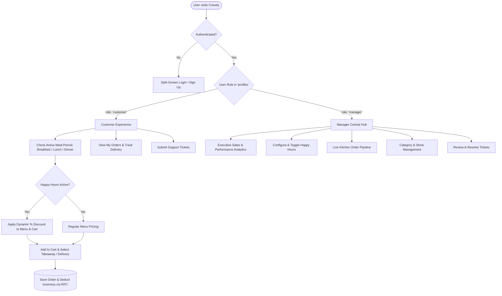

# Cravely — Modern Food Delivery & Restaurant Management Platform


**Cravely** is a full-stack food delivery and restaurant operations application designed to streamline online ordering for customers while giving restaurant managers real-time oversight of kitchen orders, menus, analytics, scheduled meal services, and dynamic Happy Hours promotions.

---

## Table of Contents
- [Overview](#overview)
- [Recent Updates & Enhancements](#recent-updates--enhancements)
- [How It Works](#how-it-works)
- [Key Features](#key-features)
  - [Happy Hours Discount Engine](#happy-hours-discount-engine)
  - [Customer Experience](#customer-experience)
  - [Manager Operations Suite](#manager-operations-suite)
  - [Authentication & Role Management](#authentication--role-management)
- [System Architecture](#system-architecture)
- [Database Schema (Supabase)](#database-schema-supabase)
- [Tech Stack](#tech-stack)
- [Getting Started](#getting-started)
  - [Prerequisites](#prerequisites)
  - [Installation](#installation)
  - [Environment Variables](#environment-variables)
  - [Running the App](#running-the-app)
- [Project Structure](#project-structure)
- [Available Scripts](#available-scripts)

---

## Overview

Cravely bridges the gap between hungry customers and restaurant managers through a unified, role-aware platform designed with a warm, modern aesthetic:
- **Forest Green** (`#263C2E`)
- **Terracotta Accent** (`#C65E38`)
- **Warm Cream** (`#F7F5EF`)
- **Sage Neutral** (`#DCE7D9`)

- **Customers** enjoy a responsive catalog to discover dishes, filter by categories and active meal times (Breakfast, Lunch, Dinner), view live Happy Hours discounts, manage an active cart, place takeaway/delivery orders, and track support tickets.
- **Managers** get a complete restaurant management back-office featuring live kitchen order tracking, dish stock controls, an executive business dashboard, dynamic Happy Hours toggle and scheduling controls, and support ticket resolution.

---

## Recent Updates & Enhancements

### 1. ⚡ Live Happy Hours Discount System
- **Manager Control Modal (`HappyHourControlModal.jsx`)**:
  - Instant Master Toggle to enable/disable Happy Hours storewide.
  - Discount presets (`10%`, `15%`, `20%`, `25%`, `30%`, `50%`) plus custom percentage input.
  - Optional IST time window schedule (e.g., 4:00 PM – 7:00 PM IST) with daily auto-activation.
  - Customizable promotional banner title and description.
  - Real-time customer dish preview showing original vs. discounted pricing.
- **Cross-Tab & Realtime Sync (`happyHourService.js`)**:
  - Zero-lag synchronization across browser tabs and devices using a resilient dual-layer engine (`BroadcastChannel` + `localStorage` + DOM CustomEvents + Supabase Realtime).
- **Customer Experience**:
  - Topbar indicator and promotional banner when Happy Hours is active.
  - Dish cards display `-XX%` badge with strike-through original prices (`~~₹200~~`) and highlighted discounted prices (`₹160`).
  - Cart breakdowns clearly itemize regular subtotal and Happy Hours discount savings before checkout.

### 2. 🎨 Unified UI/UX & Layout Architecture
- Standardized `ManagerLayout` and `CustomerLayout` wrapper shells with persistent top headers, responsive sidebars, breadcrumbs, live status pills, and mobile drawer navigation.
- Real-time IST Meal Period Synchronization: automatically filters dishes and displays hours for **Breakfast (6:00 AM – 11:00 AM)**, **Lunch (11:00 AM – 4:00 PM)**, and **Dinner (6:00 PM – 11:00 PM)**.
- Live inventory stock monitoring with warning badges for items with low stock quantities.

### 3. 🔐 Modernized Authentication Experience (`AuthPanel.jsx`)
- Premium split-screen layout with ambient glow and brand showcase highlights.
- Segmented role switcher for **Customer Login** vs. **Manager Portal**.
- Quick demo login pills (`manager` and `customer`) for fast one-click testing.
- Password visibility toggle (`Eye` / `EyeOff`) and active session management view.

---

## How It Works



---

## Key Features

### Happy Hours Discount Engine
- **Manager Toggle**: One-click dashboard toggle switch to activate or deactivate happy hours instantly.
- **Time Window Scheduler**: Option to automatically activate discounts during specified IST hours.
- **Transparent Customer Billing**: Detailed cart itemization showing original subtotal, exact discount deductions, and net payable amount.

### Customer Experience
- **Interactive Menu Catalog**: Browse categories with real-time dish pricing, preparation time, and availability flags.
- **Scheduled Meal Filtering**: Displays dishes matching the current time of day (Breakfast, Lunch, Dinner).
- **Cart & Fast Checkout**: Takeaway vs. delivery selector, quantity controls, and instant order placement.
- **Order History (`/my-orders`)**: Historical log of orders, itemized receipts, and order statuses.
- **Support Tickets (`/my-tickets`)**: Direct channel to raise inquiries or report delivery issues.

### Manager Operations Suite
- **Executive Dashboard (`/dashboard`)**: Sales summaries, recent orders, ticket counter, and quick Happy Hours switch.
- **Kitchen Order Pipeline (`/orders`)**: Advance order states from received to preparing, ready, and delivered.
- **Menu & Inventory Control (`/categories`)**: Update prices, edit categories, and adjust available quantities.
- **Support Desk (`/tickets`)**: Review open tickets and resolve customer issues.

### Authentication & Role Management
- Secure session management with token persistence and role-based route guards.
- Automatic routing based on role (`/dashboard` for managers, `/customer` for diners).
- Demo autofill shortcuts to switch between manager and customer workflows quickly.

---

## System Architecture

- **Frontend**: Single Page Application built with **React 19** and bundled with **Vite 8**.
- **Icons & Styling**: **Lucide React** paired with a unified CSS design system (`App.css`).
- **Routing**: **React Router v7** managing client-side navigation and role guards.
- **State & Synchronization**: React hooks paired with `BroadcastChannel` and Supabase Realtime.
- **Backend as a Service (BaaS)**: **Supabase** providing PostgreSQL database, Row Level Security (RLS), and database RPCs (`create_order`, `manage_order_status`).

---

## Database Schema (Supabase)

| Table | Description | Key Fields |
|---|---|---|
| `profiles` | Extended user profile data | `id` (references auth.users), `role` (`customer` \| `manager`), `created_at` |
| `food_categories` | Menu classification and meal periods | `id`, `name`, `description`, `meal_period`, `created_at` |
| `food_items` | Individual dishes and inventory stock | `id`, `category_id`, `name`, `price`, `available_quantity`, `is_available` |
| `orders` | Customer orders | `id`, `user_id`, `subtotal`, `status`, `order_type`, `created_at` |
| `order_items` | Individual line items per order | `id`, `order_id`, `food_item_id`, `quantity`, `unit_price`, `line_total` |
| `tickets` | Customer service tickets | `id`, `user_id`, `subject`, `description`, `status`, `created_at` |
| `store_settings` | Global store configurations (Happy Hours) | `key` (PK), `value` (JSONB), `updated_at` |

---

## Tech Stack

- **UI & Framework**: React 19, JavaScript (ESModules)
- **Icons**: Lucide React
- **Tooling & Bundler**: Vite 8, Oxlint
- **Routing**: React Router DOM 7
- **Database & Auth**: `@supabase/supabase-js`
- **Styling**: Custom CSS design system with Forest Green (`#263C2E`) and Terracotta (`#C65E38`) themes.

---

## Getting Started

### Prerequisites
- [Node.js](https://nodejs.org/) (version 18+ recommended)
- `npm` or `yarn` / `pnpm`
- A [Supabase](https://supabase.com/) project

### Installation

1. Clone the repository:
   ```bash
   git clone https://github.com/Kishanfdt/Food-Delivery-Application.git
   cd Food-Delivery-Application
   ```

2. Install dependencies:
   ```bash
   npm install
   ```

### Environment Variables

Create a `.env.local` file in the root of the project:

```env
VITE_SUPABASE_URL=https://your-project-id.supabase.co
VITE_SUPABASE_PUBLISHABLE_KEY=your-supabase-anon-or-publishable-key
```

### Database Setup

Run the SQL migration script located in [`supabase_setup.sql`](supabase_setup.sql) inside your Supabase project's SQL Editor to initialize tables, RLS policies, and RPC stored procedures.

### Running the App

Start the development server:
```bash
npm run dev
```

Open [http://localhost:5173](http://localhost:5173) in your browser.

---

## Project Structure

```text
├── index.html                       # HTML entry point
├── package.json                     # Project dependencies and scripts
├── vite.config.js                   # Vite configuration
├── .gitignore                       # Ignored files (node_modules, .env*, dist, archives)
├── supabase_setup.sql               # Database migration and seed SQL script
├── public/                          # Static assets
└── src/
    ├── main.jsx                     # Application root mounting
    ├── App.jsx                      # Route definitions & Role-based authentication guard
    ├── App.css                      # Unified design system styles
    ├── components/
    │   ├── AuthPanel.jsx            # Modern split-screen authentication
    │   ├── CustomerLayout.jsx       # Standardized customer layout shell & topbar
    │   ├── ManagerLayout.jsx        # Standardized manager operations layout shell
    │   └── HappyHourControlModal.jsx# Manager Happy Hours configuration modal
    ├── lib/
    │   ├── supabaseClient.js        # Supabase client initialization
    │   └── happyHourService.js      # Happy Hours state manager & cross-tab sync engine
    └── pages/
        ├── LoginPage.jsx            # Customer & Manager authentication page
        ├── CustomerHome.jsx         # Dining menu, Happy Hours banners, and cart checkout
        ├── MyOrders.jsx             # Customer order history and status tracking
        ├── CustomerTickets.jsx      # Customer support ticket filing
        ├── ManagerHome.jsx          # Manager operations launchpad
        ├── Dashboard.jsx            # Sales analytics, order metrics & Happy Hours toggle
        ├── Categories.jsx           # Menu and category inventory manager
        ├── Orders.jsx               # Kitchen order status pipeline
        └── ManagerTickets.jsx       # Support ticket resolution desk
```

---

## Available Scripts

| Command | Action |
|---|---|
| `npm run dev` | Starts the local development server with Vite HMR |
| `npm run build` | Compiles and bundles production-ready assets to `dist/` |
| `npm run preview` | Locally serves the production build |
| `npm run lint` | Runs Oxlint for ultra-fast code quality checks |

---

## License

This project is open-source and available under the [MIT License](LICENSE).
