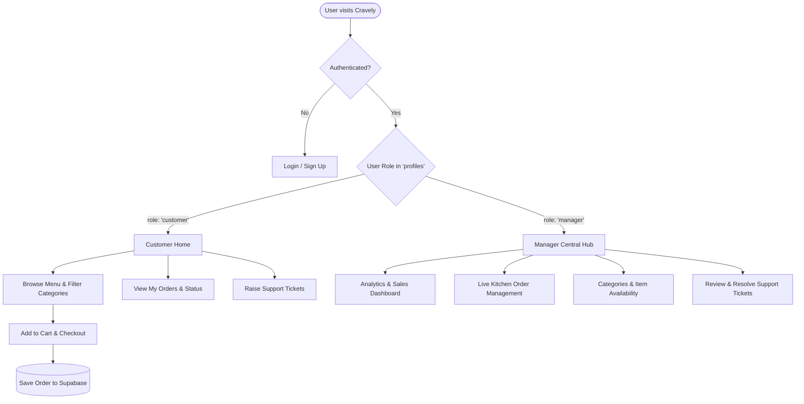

# Cravely — Modern Food Delivery & Restaurant Management Platform


**Cravely** is a full-stack food delivery and restaurant operations application designed to streamline online ordering for customers while giving restaurant managers real-time oversight of kitchen orders, menus, analytics, and customer support.

---

## Table of Contents
- [Overview](#overview)
- [How It Works](#how-it-works)
- [Key Features](#key-features)
  - [Customer Experience](#customer-experience)
  - [Manager Operations Suite](#manager-operations-suite)
  - [Authentication & Role Management](#authentication--role-management)
- [System Architecture](#system-architecture)
- [Database Schema (Supabase)](#database-schema-supabase)
- [Tech Stack](#tech-stack)
- [Getting Started](#getting-started)
  - [Prerequisites](#prerequisites)
  - [Installation](#installation)
  - [Environment Variables](#environment-variables)
  - [Running the App](#running-the-app)
- [Project Structure](#project-structure)
- [Available Scripts](#available-scripts)

---

## Overview

Cravely bridges the gap between hungry customers and restaurant managers through a unified, role-aware platform. 

- **Customers** enjoy a responsive catalog to discover dishes, filter by categories, manage an active cart, place orders, track delivery milestones, and submit customer service tickets.
- **Managers** get a complete restaurant management back-office featuring live order tracking, category and dish availability controls, business dashboard analytics, and customer ticket resolution.

---

## How It Works



1. **Authentication & Role Resolution**: Users authenticate via email and password using Supabase Auth. Upon login, Cravely queries the user's role (`customer` or `manager`) from the `profiles` table and routes them to their dedicated workspace.
2. **Catalog & Cart Pipeline**: Food categories and available dishes are dynamically queried from Supabase. The interactive cart calculates items, quantities, and sub-totals in real-time.
3. **Order Lifecycle**: When a customer confirms an order, it is persisted to Supabase with an initial status of `pending`. Restaurant managers receive and advance the status (`pending` → `preparing` → `ready` → `delivered`).
4. **Customer Care & Ticketing**: Customers can file help tickets directly linked to their account. Managers can review tickets, take action, and resolve issues.

---

## Key Features

### Customer Experience
- **Interactive Menu Catalog**: Browse categories (Starters, Main Course, Beverages, Desserts, etc.) with real-time dish pricing, preparation time, and availability flags.
- **Live Search & Filter**: Instant filtering by keywords and culinary categories.
- **Cart & Fast Checkout**: Slide-out cart to update quantities, view order totals, input delivery details, and place orders.
- **Order History (`/my-orders`)**: Full historical log of placed orders, breakdown of items, and current delivery status.
- **Customer Support (`/my-tickets`)**: Direct channel to raise questions, report missing items, or request assistance.

### Manager Operations Suite
- **Manager Hub (`/manager`)**: Central launchpad providing quick navigation across operational tools.
- **Performance Dashboard (`/dashboard`)**: Key performance indicators, daily order counts, revenue summaries, and restaurant health metrics.
- **Order Pipeline (`/orders`)**: Real-time kanban/list view of kitchen tickets to advance order states from preparation to dispatch.
- **Menu Management (`/categories`)**: Toggle dish availability on the fly (e.g., mark sold-out items) and update category structures.
- **Support Helpdesk (`/tickets`)**: Review open tickets submitted by customers, address queries, and update resolution statuses.

### Authentication & Role Management
- Secure user session handling with token persistence and session recovery.
- Route protection guards that prevent unauthorized access to manager endpoints.
- Role fallback handling and logout safeguards.

---

## System Architecture

- **Frontend**: Single Page Application built with **React 19** and bundled with **Vite 8** for ultra-fast Hot Module Replacement (HMR).
- **Routing**: **React Router v7** managing client-side navigation, parameter extraction, and declarative role-based redirects.
- **State Management**: React state hooks (`useState`, `useEffect`, `useMemo`) for responsive UI states and optimistic updates.
- **Backend as a Service (BaaS)**: **Supabase** providing authentication, PostgreSQL relational database, Row Level Security (RLS), and REST/RPC APIs.

---

## Database Schema (Supabase)

The core relational database model includes:

| Table | Description | Key Fields |
|---|---|---|
| `profiles` | Extended user profile data | `id` (references auth.users), `role` (`customer` \| `manager`), `created_at` |
| `food_categories` | Menu classification | `id`, `name`, `description`, `created_at` |
| `food_items` | Individual menu items | `id`, `category_id`, `name`, `price`, `preparation_time`, `is_available` |
| `orders` | Placed customer orders | `id`, `user_id`, `total_amount`, `status`, `delivery_address`, `created_at` |
| `order_items` | Order line items | `id`, `order_id`, `food_item_id`, `quantity`, `price` |
| `tickets` | Customer service tickets | `id`, `user_id`, `subject`, `description`, `status`, `created_at` |

---

## Tech Stack

- **UI & Framework**: React 19, JavaScript (ESModules)
- **Tooling & Bundler**: Vite 8, Oxlint
- **Routing**: React Router DOM 7
- **Database & Auth**: `@supabase/supabase-js`
- **Styling**: Tailored, modern CSS design system with micro-interactions and responsive flex/grid layouts.

---

## Getting Started

### Prerequisites
- [Node.js](https://nodejs.org/) (version 18+ recommended)
- `npm` or `yarn` / `pnpm`
- A [Supabase](https://supabase.com/) project

### Installation

1. Clone the repository:
   ```bash
   git clone https://github.com/Kishanfdt/Food-Delivery-Application.git
   cd Food-Delivery-Application
   ```

2. Install dependencies:
   ```bash
   npm install
   ```

### Environment Variables

Create a `.env.local` file in the root of the project:

```env
VITE_SUPABASE_URL=https://your-project-id.supabase.co
VITE_SUPABASE_PUBLISHABLE_KEY=your-supabase-anon-or-publishable-key
```

> **Note**: Do not commit `.env.local` to source control. It is already included in `.gitignore`.

### Running the App

Start the development server:
```bash
npm run dev
```

Open [http://localhost:5173](http://localhost:5173) in your browser to view the application.

---

## Project Structure

```text
├── index.html              # HTML entry point
├── package.json            # Project dependencies and scripts
├── vite.config.js          # Vite configuration
├── .gitignore              # Ignored files (node_modules, .env*, dist)
├── public/                 # Static assets (favicons, SVGs)
└── src/
    ├── main.jsx            # Application root mounting
    ├── App.jsx             # Route definitions & Role-based authentication guard
    ├── App.css             # Main component styles & layout rules
    ├── index.css           # Global CSS variables, resets, and typography
    ├── assets/             # Brand logos and images
    ├── components/         # Reusable UI components (AuthPanel, MenuList, etc.)
    ├── lib/
    │   ├── supabaseClient.js  # Supabase client initialization
    │   └── menuApi.js         # Menu query helper functions
    └── pages/
        ├── LoginPage.jsx      # Customer & Manager authentication
        ├── CustomerHome.jsx   # Menu browsing, cart, and order placement
        ├── MyOrders.jsx       # Customer order history
        ├── CustomerTickets.jsx# Customer ticket submission and status
        ├── ManagerHome.jsx    # Central back-office navigation hub
        ├── Dashboard.jsx      # Sales, metrics, and restaurant overview
        ├── Categories.jsx     # Category and dish availability management
        ├── Orders.jsx         # Live kitchen order status manager
        └── ManagerTickets.jsx # Support ticket resolution desk
```

---

## Available Scripts

| Command | Action |
|---|---|
| `npm run dev` | Starts the local development server with Vite HMR |
| `npm run build` | Compiles and bundles production-ready assets to `dist/` |
| `npm run preview` | Locally serves the production build |
| `npm run lint` | Runs Oxlint for ultra-fast code quality checks |

---

## License

This project is open-source and available under the [MIT License](LICENSE).
